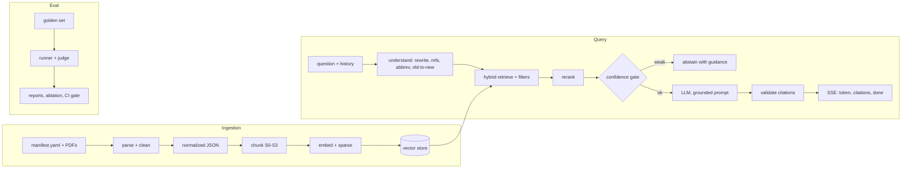

# Legal Assist RAG

A production-style, locally runnable RAG service for Indian legal and banking questions. It ingests a
versioned corpus, retrieves with structure-aware chunking and hybrid search, answers with validated
passage-level citations, abstains when evidence is weak, and ships with an evaluation harness, abuse
controls, metrics/tracing, a small web UI and CI.

> Informational only; not legal advice.

**Honest status:** the engineering is built and tested (205 tests, 94% line coverage) against a small
*synthetic fixture corpus*. The real corpus (~100 PDFs), the verified golden set and every real-model
experiment are still to do, so **no retrieval-quality or answer-quality number in this repo is measured on
real data.** `eval/experiment_log.md` is empty on purpose. See [Not done](#not-done).

## Architecture



Stages are separate callables; retrieval returns structured results (`SearchResult`), the pipeline is
stateless (history is injected), and the same code path serves the API and the eval runner.

## Quickstart

```bash
uv sync                                   # or: pip install -e . pytest pytest-asyncio pytest-cov ruff
cp .env.example .env                      # set LLM_API_KEY (Groq) and ADMIN_API_KEY
uv run pytest && uv run ruff check .
make demo                                 # fixture corpus + fake LLM, UI at http://127.0.0.1:8000/ui/
```

Index your own corpus and serve it:

```bash
python -m legal_rag.ingestion draft                 # draft manifest entries from data/raw
python -m legal_rag.ingestion validate
python -m legal_rag.ingestion --yes reindex --all
python -m legal_rag.ingestion --yes report          # docs/ingestion_report.md
uvicorn legal_rag.api.main:create_app --factory
curl -N -X POST localhost:8000/v1/ask -H 'content-type: application/json' \
     -d '{"question":"What is the punishment for theft?"}'
```

Windows without `make`: `.\make.ps1 <target>`. Docker: `docker compose up -d --build` (see limitations).
Set `EMBEDDING_MODEL=all-MiniLM-L6-v2` and install `uv sync --extra embeddings` for a real embedder; the
offline `hashing-512` embedder is for tests and CI only.

## API (all under `/v1`, OpenAPI at `/docs`)

| Endpoint | Purpose |
|---|---|
| `POST /v1/ask` | SSE stream: `token`, `citations` (structured + sanitized answer + currency notes), `abstained`, `done`, `error`. Optional `domain`, `conversation_id`, `upload_id`. |
| `POST /v1/documents/upload?filename=` | Raw-body upload (.pdf/.txt, size/page/chunk caps) into an ephemeral, isolated, TTL-bound index |
| `DELETE /v1/documents/session/{upload_id}` | Delete an upload now |
| `GET /v1/stats`, `GET /v1/metrics` | Corpus counts; latency p50/p95 per stage, error and abstention rate |
| `POST /v1/feedback` | Thumbs up/down tied to the request ID |
| `GET /v1/admin/traces/{request_id}`, `DELETE /v1/admin/documents/{doc_id}` | Admin (`X-API-Key`; disabled if `ADMIN_API_KEY` unset) |
| `GET /health`, `GET /ready` | Liveness; readiness of LLM, embedder, store |

Controls: CORS allow-list, per-IP rate limit, request-size limits (bounded streaming for uploads), question
length cap, secret-scrubbed JSON logs with request IDs, retrieved/uploaded text delimited as untrusted data.
Tracing is **opt-in** (`TRACE_PATH`), writes question/answer but never the prompt text.

## What is built

| Area | State |
|---|---|
| Config, Groq client with retry/backoff, sessions (TTL + cap), SSE streaming, request IDs | tested |
| Manifest schema + validation, parsing/cleaning, normalized JSON, chunkers S0-S3, ToC exclusion, token limits | tested |
| In-memory and Qdrant (in-process) stores; fingerprint guard; safe-order updates; embedding cache; ingestion CLI | tested |
| Hybrid RRF retrieval, weights, filters, section pinning, router, reranker interface, parent-child, query understanding | tested; **unmeasured** |
| Prompts v1/v2, citation validation, currency notes, abstention + tuner, faithfulness-guard prototype | tested with fakes |
| Eval: golden schema/authoring/freeze, metrics, LLM judge, runner, bake-off, ablation, CI gate | tested on fixtures |
| Upload chat, metrics, file tracing, static UI (`/ui`), staged-artifact guard, load/demo scripts | tested |
| Dockerfile, compose, GitHub Actions | written; see limitations |

## Not done

* **Corpus and golden set** (yours to supply): `data/manifest.yaml`, ~100 PDFs (`docs/corpus_plan.md`), ~100
  verified questions (`eval/golden/README.md`). Only 8 synthetic CI questions exist.
* **All real-data results:** B0 baseline, the B1-B6 ablation, embedding bake-off, abstention threshold, judge
  audit, `P_final`, the single frozen test run. `R_final`/`P_final` configs are provisional placeholders.
* **Not built:** Langfuse (a local JSONL tracer is used instead), hosted reranker, OCR, Hindi/multilingual
  evaluation, UI compare mode and voice, Redis sessions, PDF page anchors in citations.
* **Never run here:** Docker image build/compose (daemon was unavailable), GitHub Actions (including the
  advisory `pip-audit` step), a real LLM, a real cross-encoder or sentence-transformer, Qdrant server mode.
* `uv.lock` predates the newer dependencies; run `uv lock`.

## Limitations

Rate limiting and sessions are per-process (use Redis-style stores to scale out); the Content-Length check
does not cover chunked bodies except on upload, which streams with a hard cap; prompt-injection defences are
structural (delimiting, escaping, rules) and their effect on a real LLM is untested
(`eval/injection/` has 5 hostile documents for that experiment); judge scores are unaudited.

## Docs

`DESIGN.md` (decisions and what is unmeasured) · `EVAL.md` (method) · `docs/load_test.md` ·
`docs/demo_script.md` · `docs/resume_kit.md` · `docs/roadmap/` · `docs/corpus_plan.md` ·
`docs/metadata_schema.md`.
